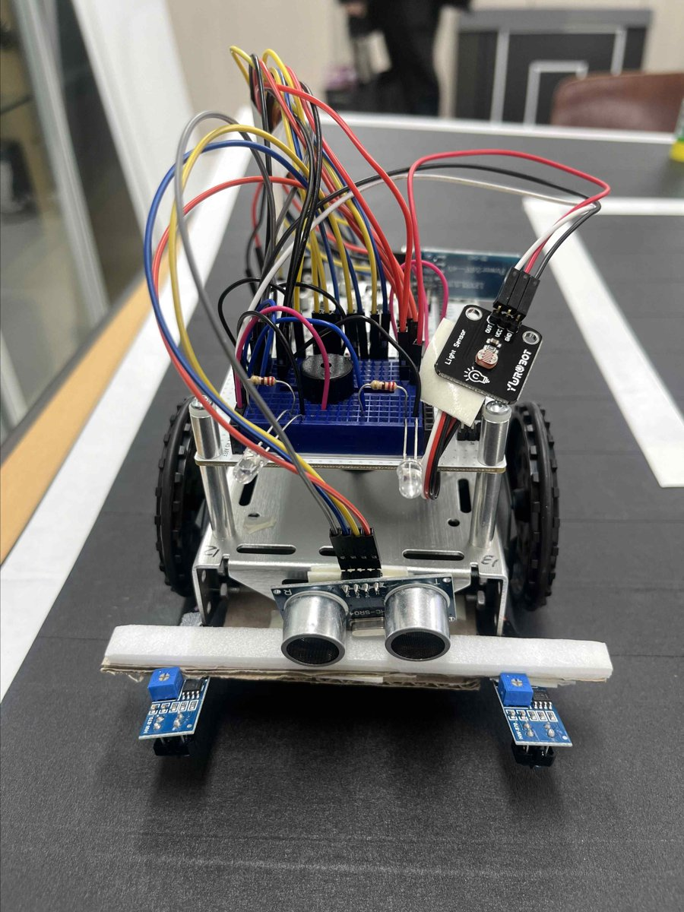

# IoT 스마트카 시스템

ABot과 Arduino로 라인트래킹 주행, 장애물 감지 시 긴급 정지, 블루투스 원격 명령에 따른 자동 소환과 자동 주차,
주변 밝기에 따른 자동 전조등을 구현한 모형 자율주행 보조 시스템입니다.
차선 유지 보조(LKA), 자동 긴급 제동(AEB), 스마트 소환/원격 주차 같은 실제 ADAS 기능을 축소해 구현하는 것을 목표로 했습니다.

## 개요

| 항목 | 내용 |
| --- | --- |
| 기간 | 2025.11 ~ 2025.12 (약 4주) |
| 인원 | 3명 (이나연, 변가은, 조혜인) |
| 담당 | - 블루투스 원격 제어와 주행 모드 연동<br>- 모드별 주행 로직 통합과 비상 정지 처리 |

## 기술 스택

| 분류 | 내용 |
| --- | --- |
| Language | C/C++ (Arduino Sketch) |
| Board | Arduino UNO, ABot 스마트카 키트 |
| Communication | HC-06 블루투스 모듈 (SoftwareSerial) |
| Tool | Arduino IDE, 스마트폰 블루투스 컨트롤러 앱 |

## 하드웨어 구성



| 기능 | 부품 | 핀 |
| --- | --- | --- |
| 블루투스 | HC-06 (RX/TX) | D5, D6 |
| 앞 초음파 | TRIG / ECHO | D8, D9 |
| 뒤 초음파 | TRIG / ECHO | D10, D11 |
| 라인트래킹 | LEFT / RIGHT | D2, D4 |
| 구동 모터 | 연속 회전 서보 RIGHT / LEFT | D12, D13 |
| 전조등 | LED Left / Right | A0, A1 |
| 조도 센서 | LDR | A2 |
| 부저 | BUZZER | A3 |

## 주요 기능

스마트폰에서 블루투스로 한 글자 명령을 보내 모드를 바꿉니다.

| 명령 | 모드 | 동작 |
| --- | --- | --- |
| `D` | 라인트래킹 주행 | 흰색 차선을 따라 주행, 앞 장애물이 8cm 이내면 정지하고 경고음 |
| `S` | 자동 소환 | 차선을 따라 사용자 쪽으로 이동, 10cm 이내에 도착하면 정지 |
| `P` | 자동 주차 | 뒤 초음파로 벽과의 거리를 재며 후진, 앞뒤 정렬을 3회 반복한 뒤 완료 알림 |
| `X` | 비상 정지 | 어떤 모드에서든 즉시 정지 |

- 자동 전조등: 모든 모드에서 조도 센서 값을 계속 확인해, 어두워지면 LED 전조등을 켬

## 구현 내용

### 1. 블루투스 명령과 모드 전환

- `loop()`에서 블루투스로 들어온 명령을 읽어 모드를 실행하고, 줄바꿈 문자는 무시
- 각 모드는 반복문으로 동작하며, 반복할 때마다 블루투스 입력을 확인해 `X`가 들어오면 바로 빠져나오도록 구성
- 모드 시작, 장애물 감지, 주차 완료를 서로 다른 부저음과 LED로 구분해 차량 상태를 알 수 있도록 함

### 2. 라인트래킹

두 센서 값만으로 판단하면 급커브에서 차선을 놓치기 쉬워, 마지막으로 차선을 감지한 방향을 상태(`traceMode`)로 기억하는 방식으로 구현했습니다.

- 직진 상태에서 한쪽 센서가 차선을 감지하면 그 방향을 기억
- 반대쪽 센서까지 차선을 감지하면 급커브로 판단해 잠시 멈춘 뒤 강하게 회전
- 그 외에는 기억한 방향으로 조금씩 보정 조향

### 3. 자동 주차

```
1단계: 왼쪽으로 곡선 후진 (뒤 거리 8cm 이내 또는 2초 경과 시 정지)
2단계: 직선 후진으로 깊이 맞추기
3단계: 앞으로 조금 갔다가 다시 후진을 3회 반복해 차체 정렬
완료: LED와 부저를 3회 깜빡여 주차 완료 알림
```

- 초음파 센서가 거리를 못 읽으면 0을 돌려주기 때문에, 거리 조건과 함께 시간 제한(2초)을 두어 차량이 계속 후진하지 않도록 처리
- 주차 중에도 `X` 명령으로 즉시 중단 가능

## 트러블슈팅

### 1. 블루투스 통신이 불안정한 문제

- 문제: 초기 버전에서는 블루투스 명령이 제대로 들어오지 않거나, 스케치 업로드와 시리얼 모니터 확인이 원활하지 않았습니다.
- 원인: HC-06을 Arduino의 0, 1번 핀(하드웨어 시리얼)에 연결했는데, 이 핀은 USB 업로드와 시리얼 모니터가 함께 쓰는 핀이라 통신이 서로 충돌했습니다.
- 해결: `SoftwareSerial`로 블루투스를 5, 6번 핀에 따로 연결해, USB 시리얼은 디버깅 로그용으로, 블루투스는 명령 수신용으로 분리했습니다.

### 2. 주행 중에 비상 정지 명령이 듣지 않는 문제

- 문제: 주행 모드는 반복문 안에서 계속 동작하기 때문에, 한 번 모드에 들어가면 다른 명령을 받을 수 없었습니다.
- 해결: 주행, 소환, 주차의 모든 반복문 안에서 블루투스 입력을 확인하고, `X`가 들어오면 즉시 반복문을 빠져나오도록 구조를 바꿨습니다.

## 향후 보완 사항

- 밝기 기반 라인트래킹 센서는 차선이 끊기거나 그림자, 조명 변화가 있으면 경로를 놓칠 수 있어, 카메라 영상 처리(OpenCV 등) 기반 차선 인식으로 개선이 필요합니다.
- 뒤 초음파 센서 하나로는 차체의 기울기나 양옆 간격을 알기 어려워, 센서를 추가해 주차 정확도를 높일 수 있습니다.

## 회고

- 블루투스 통신과 주행 모드를 연동하면서 여러 번 오작동이 발생했고, 원인을 하나씩 확인하는 과정에서 코드 구조를 체계적으로 정리할 수 있었습니다.
- 센서 값을 읽고, 상황을 판단하고, 모터를 제어하는 자율주행의 기본 흐름을 직접 구현하며 이론보다 실습에서 더 많은 것을 배울 수 있었습니다.

## 결과물

- 소스 코드: [Smart_Car.ino](./src/Smart_Car.ino)
- 개발 보고서: [IoT 스마트카 시스템 개발보고서 (PDF)](./reports/pdf/IoT%20스마트카%20시스템_개발보고서.pdf)
- 주간 진행 보고서: [reports/pdf](./reports/pdf)
- 시연 영상: [IoT 스마트카 시스템 시연 영상](./videos/IoT스마트카시스템_시연동영상.mp4)
